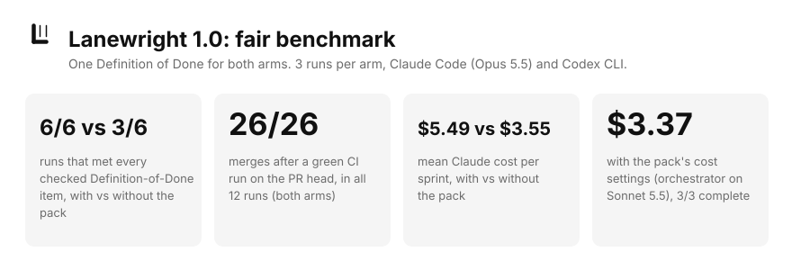
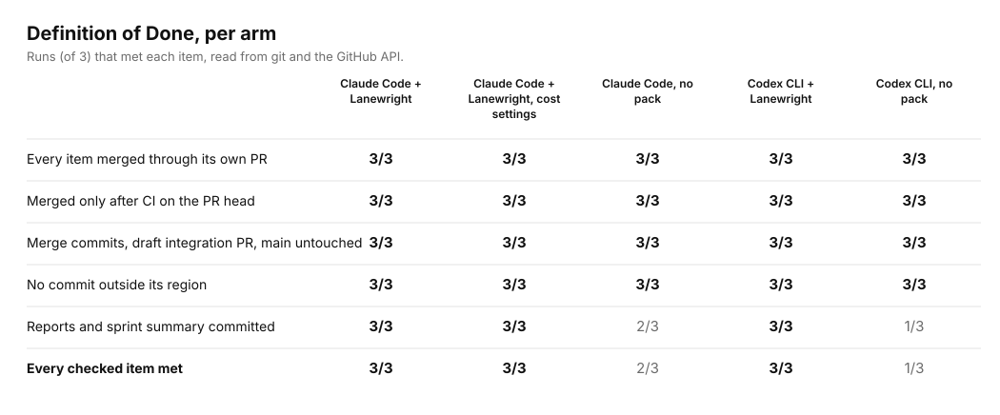
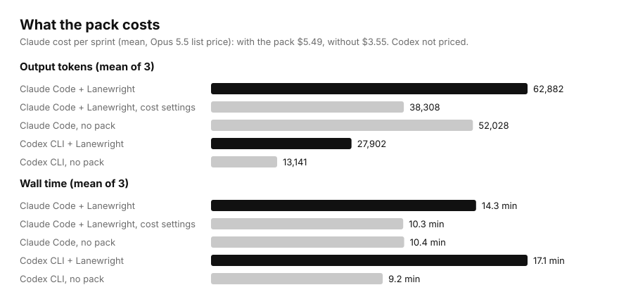

  <picture>
    <source media="(prefers-color-scheme: dark)" srcset="brand/logo-dark.svg">
    
  </picture>

<strong>Scrum sprints for AI coding agent teams.</strong> 
Every role in its own lane, every handoff through a reviewed, CI-gated merge request.

  

One Definition of Done for both arms, 3 runs per arm, Claude Code (Opus 5.5) and Codex CLI. <a href="#numbers">Numbers</a>.

# Lanewright

Lanewright is a paid agent skill that runs a Scrum team of AI coding agents in one git repository.
An orchestrating session plays Scrum Master and hands each backlog item to separate roles:
implementer, QA, reviewer, and where the project needs them, schema, API contract, tooling and
security. Each role works in its own git worktree and may only commit the files its region owns.
An ownership check runs before every commit, and an item merges only after a green CI run on its
exact head commit and an independent review.

One install, five modes: **setup**, **sprint**, **hotfix**, **release** and **worktree**. It runs
in Claude Code (roles as parallel headless sessions with tool-level file locks) and in other agents
that can run git and Python, such as Codex CLI (one session plays each role in turn).

**Get it:** [Lanewright on Agensi](https://www.agensi.io/r/HUZAIRSAPUTRA?to=/skills/lanewright-sprint-workflow-for-ai-coding-agent-teams) (referral link).
**Free alternative:** [scrum-kit](https://github.com/huzairsaputra/scrum-kit), the MIT Claude Code
plugin Lanewright grew out of (commands and prompts in Bahasa Indonesia).

This repository holds the public benchmark records and brand files only. The skill itself is not
here.

| Path | What it is |
|---|---|
| `bench/` | benchmark reports, prompts, per-run data, the scoring script and the chart script |
| `brand/` | logo, mark, icon tiles and the logo rationale (`LOGO.md`) |

## Numbers

One sprint of a two-module Go repository. BE-1 adds a function. BE-2 runs a code generator that
also writes into the other module, which no role may commit. **Both arms got the same Definition
of Done** (separate implementer, QA and reviewer, one PR per item merged only after green CI on its
head, regions respected, reports, a draft integration PR); the pack arm was also told to use the
pack. 3 runs per arm.

- **With the pack, every run met every checked item: 6 of 6. Without it, 3 of 6.** Every miss
  was the same: reports and the sprint summary were never committed. Two Codex runs said the
  configuration had no region for documents. The pack defines one, so nobody has to guess.
- **A strong model follows most of the process when you write it out.** Without the pack, Claude
  Code still ran a separate implementer, QA and reviewer per item, merged only after CI and kept to
  the regions. The pack's value here is completeness and consistency, not doing work the model
  would skip.
- **Codex runs one session either way.** With the pack, that is the documented portable mode
  (role switches, a report-blind reviewer). Without it, Codex reported "separate sessions" that did
  not exist.

**What it costs.** In Claude Code with Opus 5.5 everywhere, $5.49 per sprint with the pack against
$3.55 without: about 1.5× the cost and 1.4× the time. With the pack's cost settings (orchestrator
on Sonnet 5.5, roles kept on Opus 5.5), three more runs cost **$3.37** on average, took 10.3
minutes and still met every checked item. The no-pack runs it compares with used Opus for every
session. In Codex, the pack used about 2.1× the output tokens and 1.8× the time.

**Hotfix and release.**
- **First trial:** it took an emergency hotfix to production, then stopped where it should: on a
  back-merge conflict, and at the release readiness check.
- **Second trial,** after fixing what the first one found, ran the whole path:
  - a red-then-green regression test, a review, and a PR with green CI to `main`, tagged
    `v1.0.1`;
  - the back-merge to `staging`;
  - the `v1.1.0` release merged and tagged.

  All 7 merges waited for a green CI run on their head. See
  [`bench/2026-11-06-hotfix-release.md`](bench/2026-11-06-hotfix-release.md).

Method, prompts, scoring script, per-run data and limits:
[`bench/fair-2026-11-06/`](bench/fair-2026-11-06/README.md). Redraw the charts with
`python3 bench/charts.py` (`py -I bench/charts.py` on Windows). Earlier records: the first
one-sprint benchmark ([`bench/2026-11-05-trial.md`](bench/2026-11-05-trial.md), whose
with/without comparison was not fair) and the check run of the fixes
([`bench/2026-11-05-check.md`](bench/2026-11-05-check.md)).

**Latest test (7 Nov 2026):** a one-line brief taken through the free
[Lanewright Planning](https://github.com/huzairsaputra/lanewright-planning) skills and into a sprint dry run
with Lanewright and with scrum-kit. Seven runs, 2336 s and $6.72 in total, followed by four fix runs
(3004 s, $13.03) that turned the findings into released versions of the free tools and an update of
the paid pack. Every run's time and
cost is recorded: [`bench/planning-2026-11-07/`](bench/planning-2026-11-07/README.md).

**Limits.** Six runs per side on one small repository, on Windows: read the numbers as a direction,
not a precise rate. The records use the working name of the time, scrum-kit; the pack was renamed
Lanewright on 2026-11-06.

---

© 2026 Huzair Saputra. All rights reserved. The benchmark records may be quoted with a link to this
repository.
