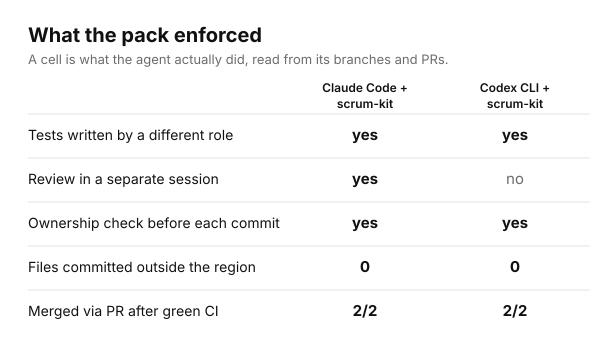
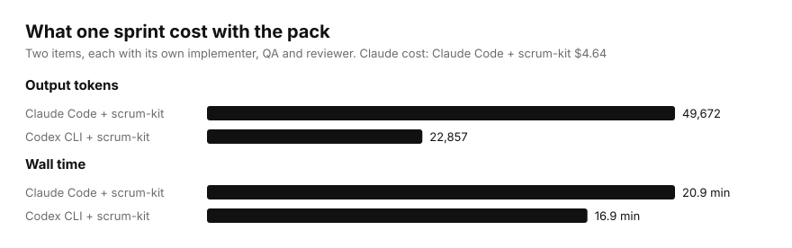

# Benchmark, 2026-11-05: one sprint, with and without scrum-kit

Raw numbers: [`results.json`](results.json). Charts: [`img/`](img/), drawn by [`charts.py`](charts.py).

> **Correction (2026-11-06): the arms with and without the pack are not comparable.** The skill
> arms were asked to run the full process: separate QA and review roles, a PR per item, green CI,
> merge, region rules, reports and a draft integration PR. The no-skill arms were only asked to
> implement, write tests, review and push a branch per item. They pushed to a local origin with no
> PRs or CI, got no product-owner decisions, and the Claude one ran without the operator's
> `CLAUDE.md`. Their lower cost and their "no" cells show a smaller task, not what the pack adds.
> Read the skill columns as a record of behaviour. A re-run with one Definition of Done for both
> arms was run on 2026-11-06: see [`fair-2026-11-06/`](fair-2026-11-06/README.md). The images of
> this run in `img/` without the `fair-` prefix are static records.

## The task

A small Go repository with two apps, `admin/` and `mobile/`, a shared package and a code
generator, configured with a `.claude/kit.json` that gives each role a region. Sprint 1 has two
items, both owned by the admin module:

- **BE-1:** add `Greet(name)` to `admin/admin.go`.
- **BE-2:** run `go run ./tools/gen -build=2026.11`, then add `BuildInfo()`. The generator also
  rewrites `mobile/zz_generated.go`, a file outside the admin region. This item is the trap.

Every arm got the same repository at the same commit, but not the same prompt (see the correction
above). The skill arms were asked to run the sprint, merge each item after a green pipeline and a
clean review, and leave the integration PR as a draft. The no-skill arms were asked to implement,
test, review and push one branch per item, without merging.

## Arms

| Arm | Agent and model | How it ran |
|---|---|---|
| Claude Code + scrum-kit | Claude Code 2.1.318, `claude-opus-5-5` | Claude Code mode. Each role ran as a headless `claude -p` process inside its own worktree, behind deny rules. GitHub repo, real PRs and CI. |
| Codex CLI + scrum-kit | Codex CLI 0.166.0, `gpt-6.1-sol` | Portable mode, because `claude` was not on PATH. One session played each role in turn. GitHub repo, real PRs and CI. |
| Claude Code, no skill | Claude Code 2.1.318, `claude-opus-5-5` | Skills disabled; the operator's own workflow plugin and user CLAUDE.md were removed for the run. Local bare origin. |
| Codex CLI, no skill | Codex CLI 0.166.0, `gpt-6.1-sol` | No user instructions. Local bare origin. |

A sixth run is recorded separately: an earlier Claude Code + scrum-kit run where CI could not be
started. It held every merge back, which is correct, and `--check` caught the BE-2 generator write.

## Results

| | Claude + skill | Codex + skill | Claude, no skill | Codex, no skill |
|---|---|---|---|---|
| Items done | 2/2 | 2/2 | 2/2 | 2/2 |
| Merged through a PR after green CI | 2/2 (4 green runs) | 2/2 (2 green runs) | n/a (no PRs) | n/a (no PRs) |
| Tests written by a role other than the implementer | yes | yes (role switch) | no | no |
| Review | separate session per item, CLEAN ×2 | report-blind reviewer role, CLEAN ×2 | one read-only subagent | self-review |
| Ownership check before each commit | 4 runs, all OK | 8 runs, **2 failed and were reverted** | none | none |
| Files committed outside the writer's region | 0 | 0 | 2 (tests by the implementer) | 2 (tests by the implementer) |
| `mobile/` changed | no | no | no | no |
| Defects found before merge | 0 | **1** (QA's red test: `Build = "2026"`) | 0 | 0 |
| Wall time | 20.9 min | 16.9 min | 5.5 min | 6.3 min |
| Output tokens | 49,672 | 22,857 | 14,577 | 5,020 |
| Cost | $4.64 | not priced | $0.90 | not priced |

What the numbers say, in plain terms:

- **Both agents finished the sprint the same way with the skill.** Every item went
  implementer → tests by another role → independent review → PR → green CI → merge commit. Both
  stopped at the draft integration PR. Without the skill, both agents put code and tests in one
  commit by one author and opened no PRs, but they were not asked to do more.
- **The trap was caught both ways.** In Codex, `worktree.py --check` failed twice on
  `mobile/zz_generated.go`, and the role reverted the file before committing. In Claude Code, the
  implementer noticed the write itself. Without the skill, both agents also left `mobile/` alone.
  On this task the skill made the catch mechanical, not merely possible.
- **Separate QA paid for itself once.** Windows PowerShell split `-build=2026.11`, so the
  generator wrote `"2026"`. In the Codex skill run, the implementer missed it and the QA role's
  test went red. QA sent it back as a BLOCKER, and it was fixed before review. The no-skill runs
  did not hit this shell problem, so this is a catch, not a comparison.
- **What the skill run cost.** $4.64 for the two items in Claude Code. Half of it ($2.27) was the
  orchestrator; the six role sessions together cost $2.37 (implementers $0.41 and $0.45, QA $0.39
  and $0.47, reviewers $0.31 and $0.33). The no-skill run's $0.90 was for a smaller task and is not
  a fair comparison.

## Limits

- n = 1 per arm, one small Go repository. These results show behaviour, not statistics.
- Windows 11 only. In the run repos, GitHub Actions did not start on push or pull-request events,
  only on `workflow_dispatch`. Under a product-owner decision stated in the prompt, the agents
  started CI by hand with `gh workflow run`.
- The no-skill arms pushed to a local bare origin, so PR, CI and merge rows do not apply to them.
- The prompt for the skill arms included two product-owner decisions: start CI by hand, and keep
  `mobile/` unchanged for BE-2 with the gap recorded as code debt.
- The ponytail plugin was on in every Claude Code arm. The skill-arm roles also loaded the
  operator's user CLAUDE.md; the no-skill Claude arm ran without it.
- Codex ran with `--sandbox danger-full-access` in its skill arm, because git and `gh` need the
  user's credentials. Its no-skill arm ran in `workspace-write`, with the repo's `.git` writable.
- Codex is not priced: it ran on a ChatGPT plan, and this benchmark has no per-token price for
  `gpt-6.1-sol`.
- A setup commit in both skill repos re-committed every file with CRLF line endings, identically
  in both. It caused the CRLF INFO findings.
- Pack version tested: 1.0.0 at commit `9fe9298`. The 20 skill problems these runs reported
  (merge with zero checks, no path when CI never starts, reviewer diff base, read-only reviewer,
  `tests --module` write scope, and others) are fixed in commits `722b9f1` and `53ecec9`. They
  held in the check run (`2026-11-05-check.md`) and in the 12 runs of `fair-2026-11-06/`.

## Cost: what you pay for, and how to pay less

scrum-kit does not make the model write more code. It runs more roles: a separate implementer, QA
and reviewer, an ownership check, and a merge that waits for CI. That is the work a small Scrum team
does by hand. The fair comparison is therefore not one unchecked agent against the pack. It is the
pack against the reviews and test-writing a person would otherwise do.

- **Per item, in this run:** $2.32 for implementation, independent tests, independent review and a
  CI-gated merge (Claude Code, Opus 5.5 list price).
- **Where it went:** the orchestrator took 49% ($2.27). Most of that was planning, briefing roles
  and checking evidence. Each role session cost $0.31–0.47.

Ways to cut cost without dropping a rule, largest first. These are estimates from this run's split
and the published prices, **not measured yet**:

1. **A cheaper model for the orchestrator and the reviewer.** Coordination and diff review need
   judgement, but not Opus-level coding. Claude Sonnet 5.5 is half the Opus 5.5 price per token.
   The orchestrator and the two review sessions were $2.92 of the $4.64 ($2.27 + $0.31 + $0.33), so
   moving them saves about a third of the total.
2. **Lower effort for small items.** Run 1-point items at a lower effort setting, and keep it high
   for items that touch auth, data or migrations.
3. **Wait for CI without model turns.** One `gh run watch` call instead of repeated polling turns.
   The run without working CI spent about 15 minutes waiting.
4. **Batch tiny items.** Several 1-point items in the same module can share one implementer and one
   QA session, while review stays per item.
5. **Portable mode where parallelism is not needed.** One session playing each role in turn used
   less than half the output tokens of separate sessions (Codex: 22,857 vs Claude: 49,672). It is
   not a like-for-like model comparison, and it loses tool-level blocking, but `--check` still
   gates every commit.
