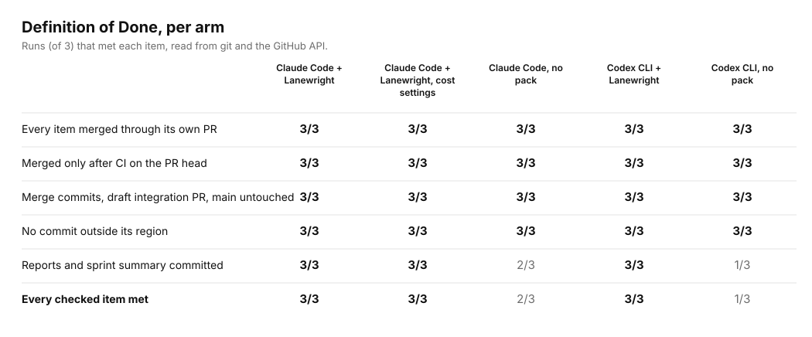
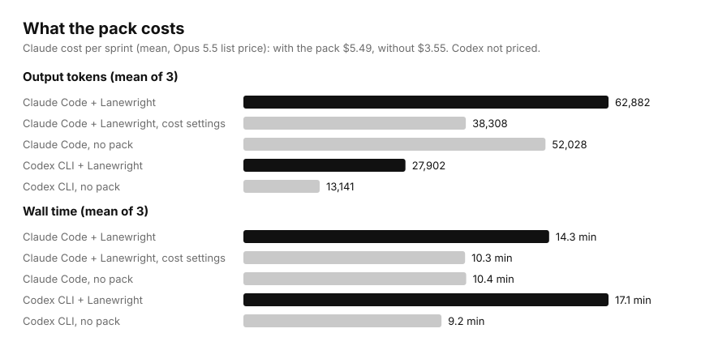

# Fair benchmark, 2026-11-06: one Definition of Done, with and without scrum-kit

This replaces the with/without comparison of 2026-11-05, which gave the arm without the pack a
smaller task. Raw data: [`results.json`](results.json). Prompts: [`common.md`](common.md) (both
arms), plus the one-line additions in [`claude-skill.md`](claude-skill.md) and
[`codex-skill.md`](codex-skill.md). Scoring: [`score.py`](score.py) (git and the GitHub API only).
Claude cost: [`claude_cost.py`](claude_cost.py) (transcripts of every process, at list price).

## Setup

- **Task:** the same two-item Go sprint as before. BE-2 runs a generator that also rewrites
  `mobile/zz_generated.go`, outside the admin region. One private GitHub repository per run, all
  built from the same files.
- **Prompt:** one Definition of Done for both arms.
  1. Tests are written by a different session from the implementer's.
  2. A reviewer who wrote neither the code nor the tests gives a verdict.
  3. Write regions in `kit.json` are respected.
  4. Each item has its own PR, merged with a merge commit only after a green CI run on its head
     commit and a CLEAN review.
  5. Reports and a sprint summary are committed.
  6. A draft integration PR is open at the end, and `main` is untouched.

  The product-owner decisions are the same for both arms (start CI by hand; keep `mobile/`
  unchanged for BE-2). The skill arm's prompt adds one line: use the pack.
- **Runs:** 3 per arm, in Claude Code (Opus 5.5 for every process, billed per token) and in Codex
  CLI (`gpt-6.1-sol`). The arms were interleaved. Pack version: commit `d89accb`.
- **Isolation:** during the Claude runs, the operator's `~/.claude/CLAUDE.md` was moved aside and
  the operator's own workflow plugin disabled, for both arms. The scrum-kit skills were installed only for skill
  runs. Codex has no user instructions.

## Results

| | Claude + pack | Claude, no pack | Codex + pack | Codex, no pack |
|---|---|---|---|---|
| Runs meeting every checked DoD item | **3/3** | 2/3 | **3/3** | 1/3 |
| Items merged through a PR after CI on its head | 6/6 | 6/6 | 6/6 | 6/6 |
| Commits outside their region | 0 | 0 | 0 | 0 |
| Reports and summary committed | 3/3 | 2/3 | 3/3 | 1/3 |
| Separate processes for implementer, QA, reviewer | yes (7 sessions per run) | yes (7–8 sessions per run) | no: one session, role switches | no: one session |
| Mean wall time | 14.3 min | 10.4 min | 17.1 min | 9.2 min |
| Mean output tokens | 62,882 | 52,028 | 27,902 | 13,141 |
| Mean cost | $5.49 | $3.55 | not priced | not priced |

What this says, plainly:

- **When the Definition of Done is written out, a strong model follows most of the process on
  its own.** Claude Code without the pack also ran a separate implementer, QA and reviewer process
  per item. It took the role names from `kit.json`, merged only after CI on the head commit, and
  kept to the regions. On this small task, the pack does not change *whether* the work gets done.
- **The pack makes the process complete every time.** All six runs with the pack met every
  checked item. Three of the six runs without it did not commit their reports and summary. Two
  Codex runs said why: "the configuration defines no documentation write region". The pack
  settles that (role reports go under `docs.reports`), so nobody had to guess.
- **It costs more.** In Claude Code, about 1.5× the cost ($5.49 vs $3.55) and 1.4× the time. In
  Codex, about 2.1× the output tokens and 1.8× the time.
- **Codex never started separate processes**, with or without the pack, even when its report said
  "separate sessions". With the pack, that is the documented portable mode (one session, role
  switches, a report-blind reviewer). Without it, the claim was simply not true. Treat Codex
  results as weaker on DoD items 2 and 3.

## Cost settings (added after the benchmark, pack `a4164cf`)

The pack now has two cost levers:

- An optional `models.roles` in `kit.json`. The orchestrator passes `--model` to every role, so
  the orchestrator can run on a cheaper model while implementer, QA and reviewer stay strong.
- Evidence checks with targeted commands (`gh pr view`, `gh run list --commit`, the verdict line,
  the `--check` lines) instead of reading whole reports.

Three more runs used the same prompt as the skill arm, with the orchestrator on
`claude-sonnet-5-5` and `models.roles` = `claude-opus-5-5`. The transcripts confirm the model of
every process.

| | Pack, Opus everywhere | **Pack, cost settings** | No pack, Opus everywhere |
|---|---|---|---|
| Runs meeting every checked DoD item | 3/3 | **3/3** | 2/3 |
| Mean cost per sprint | $5.49 | **$3.17** ($3.16, $3.19, $3.17) | $3.55 |
| Orchestrator share | about $2.3 | **about $0.79** | – |
| Mean wall time | 14.3 min | **10.3 min** | 10.4 min |

With the cost settings, the pack cost 42% less than before and 11% less than the no-pack
runs, while still completing every item. That comparison is not like-for-like on models: the
no-pack runs used Opus for every session, and a no-pack run on a cheaper orchestrator was not
measured.

**Correction (2026-11-14):** the cost script priced Sonnet 5.5 cache reads at $0.20 per million tokens; the
list price is $0.10. With the correct price the cost-settings runs cost $3.17 on average, not $3.37. The Opus-only
arms are unchanged.

## Limits

- n = 3 per arm and one small repository. The difference in report completeness (6/6 vs 3/6)
  rests on six runs per side; it is a direction, not a precise rate.
- "Every checked item" covers what git and the GitHub API can show: PRs, merge commits, CI on the
  head SHA before merge, the draft integration PR, `main`, regions, committed reports, and the
  generated label. Review quality and whether tests really came from another session were read
  from transcripts, not scored.
- The two chains (Claude and Codex) ran at the same time on one Windows machine, so the wall
  times may affect each other a little.
- CI was started by hand under a product-owner decision, because the repositories did not start
  workflows on push or pull-request events.
- Codex ran with `--sandbox danger-full-access` in both arms (git and `gh` need the user's
  credentials). Codex is not priced: it ran on a ChatGPT plan.
- The ponytail plugin was on in every Claude run, in both arms.
