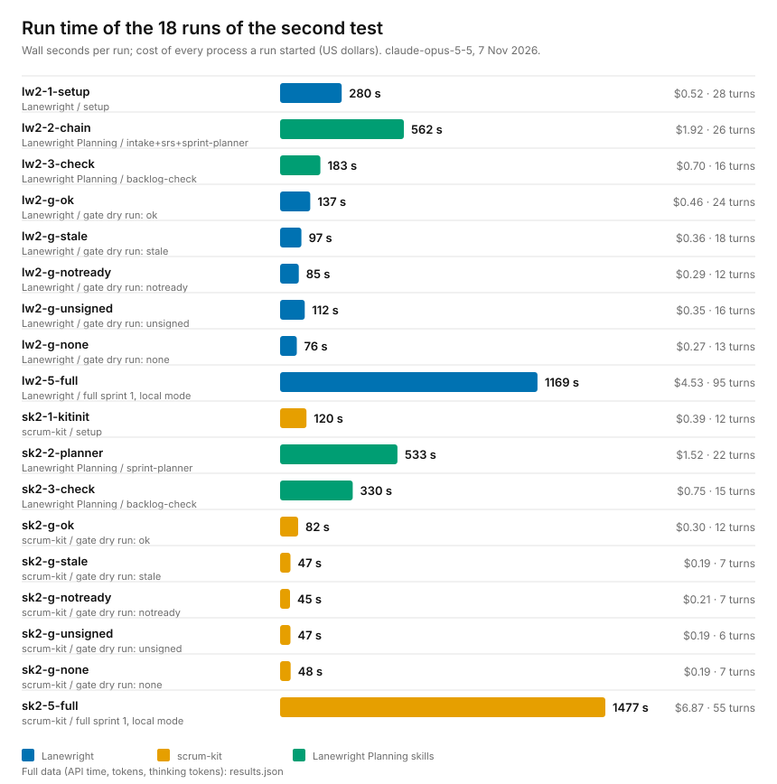

# Second end-to-end test: the readiness gate and a full sprint (7 Nov 2026)

The first test ([planning-2026-11-07](../planning-2026-11-07/README.md)) found where the tools made an
agent guess or stop, and four fix runs closed those points. This test checks the result with the
released versions: [Lanewright Planning v1.0.1](https://github.com/huzairsaputra/lanewright-planning/releases/tag/v1.0.1),
[scrum-kit v1.4.0](https://github.com/huzairsaputra/scrum-kit/releases/tag/v1.4.0) and Lanewright 1.0.1. The
new part is the **readiness gate**: before a sprint starts, the workflow reads the Backlog Check report,
compares its SHA-256 fingerprint with the backlog, and asks a human when something is off.

(PNG: [runs.png](runs.png). Raw numbers, tokens and cache tokens per run: [results.json](results.json).)

## Method

- **Input:** the same invented one-line notes-app brief as the first test. Two fresh throwaway
  repositories without a remote, one per workflow tool. Both tools plan from the **same SRS**.
- **Per tool, 9 headless runs** (`claude -p --bare`, API key only, `claude-opus-5-5`): setup; the planning
  skills (intake, SRS, sprint plan, then Backlog Check); five gate dry runs; one full sprint.
- **The human is simulated.** A script fills the sign-off block of the Backlog Check report, the way a
  product owner would. This tests the gate, not the quality of a person's decision (that is a later study).
- **Five gate scenarios** per tool, each in its own copy of the same state. The dry run follows the sprint
  preparation steps and must stop before dispatching any role:

  | Scenario | State | Expected |
  |---|---|---|
  | ok | report present, fingerprint matches, ready with warnings, sign-off filled | continue and write the "passed" line |
  | stale | the backlog was edited after the check | stop and ask once |
  | notready | verdict NOT READY, fingerprint matches, sign-off filled | stop and ask the product owner once |
  | unsigned | ready with warnings, fingerprint matches, sign-off empty | stop and ask the product owner once |
  | none | no report | stop and ask once |

- **One full sprint per tool** in local mode (no remote): all six items from preparation to the merge into
  the base branch. The standing answers were fixed in advance and written in the prompt.
- Two tracks ran in parallel, so the elapsed time is shorter than the sum of the runs.

## Results

### The gate: 10 of 10 scenarios behaved as designed

| Scenario | Lanewright | scrum-kit |
|---|---|---|
| ok | continued, committed the sprint documents, wrote the line | continued, committed the sprint documents, wrote the line |
| stale | stopped, quoted the question | stopped, quoted the question |
| notready | stopped, quoted the question | stopped, quoted the question |
| unsigned | stopped, quoted the question | stopped, quoted the question |
| none | stopped, quoted the question | stopped, quoted the question |
| Time per dry run | 76-137 s | 45-82 s |
| Cost per dry run | $0.27-0.46 | $0.19-0.30 |

In every run the agent computed the backlog fingerprint itself and its value matched the report in the
three scenarios where it should (ok, notready, unsigned), differed in the stale one, and was not compared
when there was no report. A report written in Indonesian ("SIAP DENGAN CATATAN", "BELUM SIAP") was read
correctly by both tools.

### The full sprint

| | Lanewright | scrum-kit |
|---|---|---|
| Items merged | 6 of 6 (16 SP) | 6 of 6 (17 SP) |
| Tests at the end (1 at the start) | 53 | 68 |
| Reviews | CLEAN on all three merges | clean on all three merges |
| A defect found before merge | QA's deliberately broken versions of the code were all caught | 1 (week-format dates accepted as dates), fixed before the review |
| Processes | 1 (roles played in one session) | 12 (4 on Opus, 8 on Sonnet) |
| Wall time | 1169 s | 1477 s |
| Cost, all processes | $4.53 | $6.87 |
| Turns | 95 | 146 across all processes |

- **The report's cost is not the sprint's cost.** The orchestrating process of the scrum-kit sprint
  reported $2.02; the 11 role processes it started cost $4.84 more. Totals come from every process's
  transcript at list price ([`claude_cost.py`](../fair-2026-11-06/claude_cost.py)). Both are in `results.json`.
- Lanewright's role processes could not log in inside this test setup, so that run used its portable
  mode (one session plays every role). Separate processes are covered by the
  [fair benchmark](../fair-2026-11-06/README.md); treat the two sprint columns as different modes.

### Totals

18 runs, 5430 s of run time (3473 s elapsed with two tracks in parallel), **$19.99**. Together with the
first test and the four fix runs: 29 runs, 10770 s of run time, $39.73.

## What the test found

Both full sprints ended by recording a Definition-of-Done item as "not applicable" (a negative
authorization test, in an app with no login) with the approval marked **pending**, because nobody could
answer in a non-interactive run, and merged anyway. The rule says such items need the product owner's
approval and must not be silent; it does not say what to do while the approval is missing.

**Free tools (fixes planned):**

1. **Approval for "not applicable" items should be collected earlier.** The Sprint Planner can list the
   Definition-of-Done items that do not apply to the project, and the Backlog Check sign-off, which the
   product owner already gives, can record which of them are approved. The sprint then reads the approval
   instead of waiting for it. (Lanewright Planning 1.0.2.)
2. scrum-kit names the pairing marker `Menguji: <ID>`; the Sprint Planner writes `Tests: <ID>`. The agent
   treated them as the same. Accept both. (scrum-kit 1.4.1.)
3. `claude -p --agent scrum-kit:<agent>` is not found when the plugin is not installed for the command-line
   tool; it needed `--plugin-dir` and a cleared `CLAUDE_CODE_SIMPLE`. The sprint command should say so.
4. The test gate is red before the QA tests exist when a code item replaces old behaviour; the backlog
   expected it, the rule says there is no "expected red". State the exception.
5. An item labelled "foundation" that belongs to the code agent is not a step-1 item (step 1 is for the
   shared-module and tooling roles). The planner or the text should say so.
6. Step 6.1 does not say it depends on a configured contract; where the merge record goes in local mode,
   whether the integration branch is deleted afterwards, and the handoff file saying "merge waiting" at the
   final merge are not specified.

The Lanewright run met the same classes of point; its details stay with the product.

## Limits

- One invented project and one run per cell; the approval is a script, not a person. Timing depends on
  the machine, the network and the model's load that day.
- The agents were told to stop at any question rather than answer it, so the gate is tested as a
  decision, not as a conversation.
- The dry runs stop before any role writes code; the sprint columns are one run each and are not a
  benchmark of speed or quality between the two tools.
