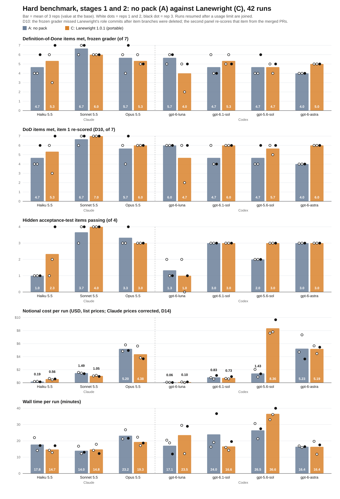

# Hard benchmark: seven models, with and without the pack (10-12 Nov 2026)

The earlier benchmark ([fair-2026-11-06](../fair-2026-11-06/README.md)) used a small task and one model, and the pack
met every checked item in 6 of 6 runs against 3 of 6 without it. This test asks whether that holds on a harder task,
across model sizes and two vendors. It was pre-registered before the first data run, and every change after that is
logged as a deviation.

(PNG: [stage1-2.png](stage1-2.png). Every run: [runs.json](runs.json).)

## Design

- **Task:** a new Go repository and one sprint of four items (BE-1 to BE-4) with dependencies across modules, an
  authorization rule the tickets only imply (BE-3, BE-4), and a code generator in BE-2 that also writes into a module
  no role may commit. Hidden acceptance tests per item, never shown to the agent.
- **Arms:** A has no pack. C runs Lanewright 1.0.1 (the exact build sold on Agensi, SHA-256 `209fd3ee…`) in portable
  mode, where one session plays each role in turn. Both arms get the same written Definition of Done (DoD) and the same
  product-owner answers.
- **Models:** Claude Haiku 5.5, Sonnet 5.5 and Opus 5.5 in Claude Code; `gpt-6-luna`, `gpt-6.1-sol`, `gpt-5.6-sol`
  and `gpt-6-astra` in Codex CLI. Pairs are matched by list price (Haiku with Luna, Sonnet with Sol 6.1, Opus with
  Sol 5.6), plus Astra on the Opus scheme. Reasoning effort fixed at medium, user instructions and plugins isolated,
  no API keys (subscriptions only).
- **Runs:** 2 per cell in stage 1 (28 runs). The pre-registered stage-2 rule flagged all seven models as
  inconsistent, so every cell got a third run (14 more). Order randomised with recorded seeds. **42 runs, all
  finished.**
- **Measures,** read from git and the GitHub API, no model as judge: DoD items met (of 7, the last one being the
  hidden suite), hidden items passing (of 4), notional cost at list prices, and wall time. The main cost measure is
  cost per passed hidden item.
- **Total:** 14.0 hours of run time and $105.33 notional (no money was spent: both vendors ran on subscriptions).

## Results

Mean of 3 runs per cell. "DoD (D10)" re-scores one DoD item; see the note under the table. The grader's numbers are
the main analysis.

| Model | Arm | DoD (grader) | DoD (D10) | Hidden items | Cost per run | Cost per passed item | Minutes |
|---|---|---|---|---|---|---|---|
| Haiku 5.5 | A | 4.7 | 4.7 | 1.0 | $0.17 | $0.17 | 17.8 |
| Haiku 5.5 | C | 5.3 | 5.3 | 2.3 | $0.27 | $0.11 | 14.7 |
| Sonnet 5.5 | A | 6.7 | 6.7 | 3.7 | $1.79 | $0.49 | 14.0 |
| Sonnet 5.5 | C | 6.0 | 7.0 | 4.0 | $1.37 | $0.34 | 14.8 |
| Opus 5.5 | A | 5.7 | 5.7 | 3.3 | $5.20 | $1.56 | 23.2 |
| Opus 5.5 | C | 5.3 | 6.0 | 3.0 | $4.38 | $1.46 | 19.3 |
| gpt-6-luna | A | 5.7 | 6.0 | 1.3 | $0.06 | $0.04 | 17.1 |
| gpt-6-luna | C | 4.0 | 4.7 | 1.0 | $0.10 | $0.10 | 23.5 |
| gpt-6.1-sol | A | 4.7 | 4.7 | 3.0 | $0.83 | $0.28 | 24.0 |
| gpt-6.1-sol | C | 5.3 | 6.0 | 3.0 | $0.73 | $0.24 | 16.6 |
| gpt-5.6-sol | A | 4.7 | 4.7 | 2.0 | $1.43 | $0.72 | 26.5 |
| gpt-5.6-sol | C | 4.7 | 5.7 | 3.0 | $8.36 | $2.79 | 36.6 |
| gpt-6-astra | A | 4.0 | 4.0 | 3.0 | $5.23 | $1.74 | 16.4 |
| gpt-6-astra | C | 5.0 | 6.0 | 3.0 | $5.19 | $1.73 | 16.4 |

**About D10.** DoD item 1 checks that implementation and tests were committed separately for each item. The frozen
grader finds an item's commits through its branch or an item ID in the commit message. Lanewright deletes item
branches after the merge, and its role commits do not repeat the item ID, so the grader found only the
documentation commits and failed item 1 in 17 of 21 runs with the pack. Reading the same commits from each merged
pull request, with the grader's own rules, gives 19 of 21 with the pack (the two misses never merged those items)
and 21 of 21 without it. The grader was not changed after the freeze; D10 is reported next to it.

Which DoD items each arm missed (runs of 21, grader):

| DoD item | A missed | C missed |
|---|---|---|
| Roles separated | 1 | 17 (2 with D10) |
| Review verdicts committed | 10 | 2 |
| Write regions respected | 0 | 0 |
| One PR per item, merged after green CI on its head | 0 | 2 |
| Reports and sprint summary committed | 10 | 1 |
| Draft integration PR | 0 | 1 |
| Whole hidden suite passing | 18 | 17 |

No run in either arm let the BE-2 generator's write into another module reach a commit.

## What it says, by hypothesis

All of this is a direction, not significance: three runs per cell on one task.

- **H1, without the pack more DoD and hidden items are missed in every model: not supported as stated.** With D10,
  the pack raised mean DoD in 6 of 7 models; Luna dropped. By the grader alone it rose in 3. What the pack fixes is
  the documented process: review verdicts and reports were missing in 10 of 21 runs without it, and in 2 and 1 of 21
  with it, the same pattern as the earlier benchmark. It did not reliably raise functional correctness: hidden items
  rose for Haiku, Sonnet and Sol 5.6, stayed the same for Sol 6.1 and Astra, and dropped slightly for Opus and Luna.
  The whole hidden suite passed in 3 of 21 runs without the pack and 4 of 21 with it.
- **H2, the pack helps small models more: mixed, by vendor.** In Claude, Haiku gained the most hidden items (+1.3).
  In Codex, Luna got worse with the pack; one of its runs merged no item at all.
- **H3, the pack costs more per run but not more per passed item on medium and large models.** The first half is
  not supported: the pack made runs cheaper for Sonnet, Opus, Sol 6.1 and Astra. The second half holds except for
  Sol 5.6, where portable mode used a very large number of tokens (17.9 million input tokens in one attempt) and cost
  per passed item went from $0.72 to $2.79.
- **H4, no consistent winner between same-price pairs: partly supported.** Quality leaned to Claude: in 7 of 8
  rows (4 pairs, 2 arms) the Claude model met as many or more DoD and hidden items. Cost leaned to Codex on the cheap
  and middle pairs. On the expensive pairs it turned: Sol 5.6 with the pack was the most expensive, and Astra cost a
  little more per passed item than Opus. Pairs are matched by price, not ability, and the generations differ.
- **H5 and H6** belong to the extra phase below.

Compared with the earlier benchmark: on a harder task the pack still makes the process complete (verdicts, reports,
summary, PR flow), but it does not by itself make the code more correct, and in Codex with Sol 5.6 it is much more
expensive.

## Deviations from the pre-registration

The pre-registration is [preregistration.md](preregistration.md) (in Indonesian, as frozen; its paths and hashes refer
to the private working repository). Every deviation is dated in its section 8, in short:

- **D1:** stage 1 ran as two parallel lanes, Claude and Codex, each in its own randomised order.
- **D2:** recording only (pilot table, raw pilot data).
- **D3, D6:** Claude's 7-day quota gate, first at 85%, then raised to 95% by the product owner. D6 also proves the
  tested pack is byte-identical to the frozen build.
- **D4, D5:** remaining order of each lane changed once after quota stops.
- **D7:** the machine went into standby during data collection, so wall time needed a check.
- **D8:** quota waits made robust to standby.
- **D9:** that check. Gaps between timestamped events in each run's own stream: no run paused for more than 3
  minutes ([event-gaps.tsv](event-gaps.tsv)), so wall times are read as they are.
- **D10:** the measurement fault in DoD item 1 described above ([roles-separated-merge.tsv](roles-separated-merge.tsv)).

Two runs were cut by a usage limit and resumed, as the pre-registration requires: `a-astra-no-2` (stage 1) and
`c-sol56-lw-3` (stage 2). Codex writes no usage for a cut attempt, so its cost was recomputed from the attempt's own
token log ($6.52 and $9.29); `runs.json` includes those costs, while its token counts cover the recorded attempts
only.

## What is not here yet

The task, the hidden tests, the prompts and the harness stay private until the extra phase has run, because it uses
them. The extra phase (16 Claude runs: Lanewright in Claude Code mode against scrum-kit 1.5.0, four model settings,
H5 and H6) starts on 15 Nov 2026. Its results and the full materials will be added here.

## Limits

One task, one language (Go), one DoD, three runs per cell, on Windows. Cross-vendor pairs are matched by list
price, and notional cost is computed from tokens at list prices; both vendors' subscriptions bill quota, not
dollars. Codex token counts are not comparable with Claude's (different tokenizers).
