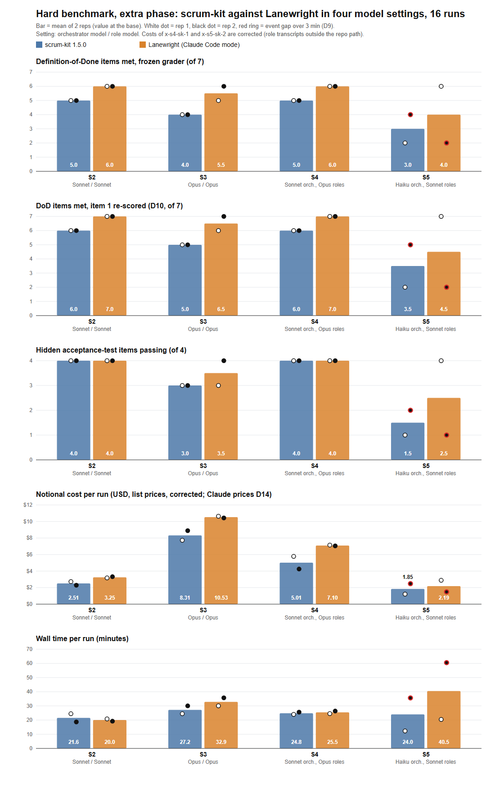
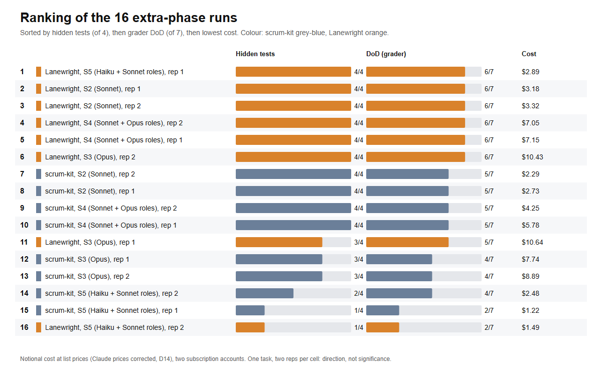
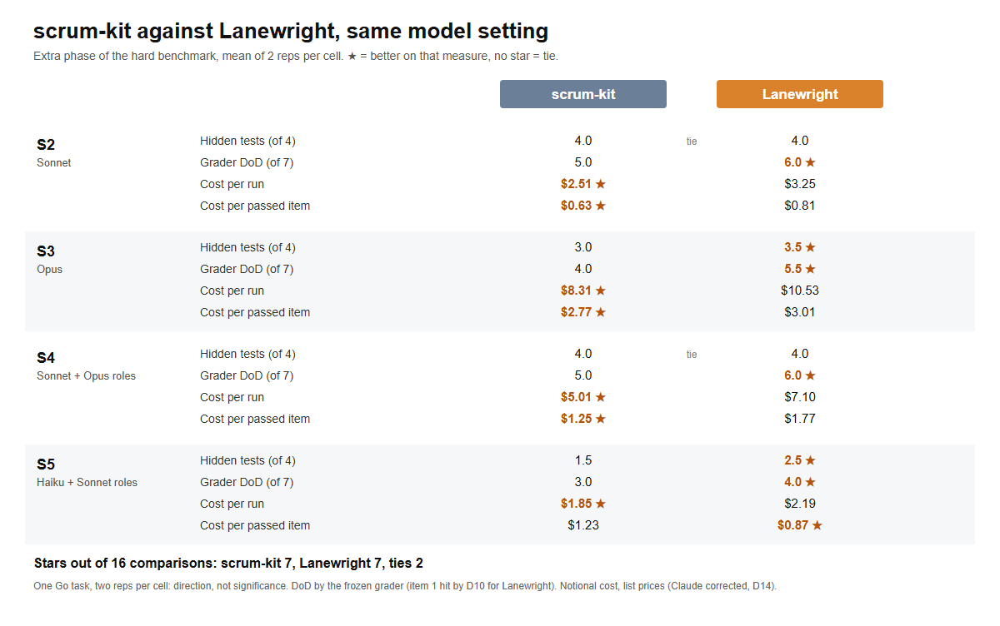

# Hard benchmark, extra phase: Lanewright against scrum-kit (13-14 Nov 2026)

Stages 1 and 2 ([README.md](README.md)) asked whether a workflow pack helps on a harder task. This phase asks two
pre-registered questions inside Claude Code: does a cheap orchestrator with stronger roles save money without losing
correctness (H5), and is either pack consistently cheaper or faster (H6)? Same task, same hidden tests, same frozen
grader and Definition of Done (DoD) as stages 1 and 2.

Every run: [runs-extra.json](runs-extra.json).

## Design

- **Settings** (orchestrator model / role model):
  - S2: Sonnet 5.5 / Sonnet 5.5
  - S3: Opus 5.5 / Opus 5.5
  - S4: Sonnet 5.5 orchestrator, Opus 5.5 roles
  - S5: Haiku 5.5 orchestrator, Sonnet 5.5 roles
- **Packs:** scrum-kit 1.5.0 (the free MIT plugin, a copy whose only change is the `model:` lines that set the role
  models) and Lanewright 1.0.1 (the same frozen build as stages 1 and 2) in Claude Code mode, where roles run as
  separate headless sessions.
- **Runs:** 4 settings × 2 packs × 2 reps = **16 runs**, Claude Code only, in a fixed random order with a recorded
  seed. All 16 finished in one attempt; none was cut by a usage limit.
- **Measures:** as before. DoD items met (of 7) by the frozen grader, with the D10 re-scoring of item 1 next to it;
  hidden acceptance-test items passing (of 4); notional cost at list prices, with cost per passed hidden item as the
  main cost measure; wall time.
- **Total:** 7.2 hours of run time and $81.50 notional (subscriptions, no money spent).

## Results

Mean of 2 runs per cell. Costs use the corrected Claude prices (D14).

| Setting | Pack | DoD (grader) | DoD (D10) | Hidden items | Cost per run | Cost per passed item | Minutes |
|---|---|---|---|---|---|---|---|
| S2 | scrum-kit | 5.0 | 6.0 | 4.0 | $2.51 | $0.63 | 21.6 |
| S2 | Lanewright | 6.0 | 7.0 | 4.0 | $3.25 | $0.81 | 20.0 |
| S3 | scrum-kit | 4.0 | 5.0 | 3.0 | $8.31 | $2.77 | 27.2 |
| S3 | Lanewright | 5.5 | 6.5 | 3.5 | $10.53 | $3.01 | 32.9 |
| S4 | scrum-kit | 5.0 | 6.0 | 4.0 | $5.01 | $1.25 | 24.8 |
| S4 | Lanewright | 6.0 | 7.0 | 4.0 | $7.10 | $1.77 | 25.5 |
| S5 | scrum-kit | 3.0 | 3.5 | 1.5 | $1.85 | $1.23 | 24.0 |
| S5 | Lanewright | 4.0 | 4.5 | 2.5 | $2.19 | $0.87 | 40.5 |

Which DoD items each pack missed (runs of 8, grader):

| DoD item | scrum-kit missed | Lanewright missed |
|---|---|---|
| Roles separated | 8 (1 with D10) | 8 (1 with D10) |
| Review verdicts committed | 1 | 1 |
| Write regions respected | 0 | 0 |
| One PR per item, merged after green CI on its head | 1 | 1 |
| Reports and sprint summary committed | 8 | 0 |
| Draft integration PR | 0 | 1 |
| Whole hidden suite passing | 4 | 2 |

The frozen grader failed item 1 in all 16 runs, with both packs, for the reason described under D10 in the README.
Reading the commits from each merged pull request gives 7 of 8 for each pack ([roles-separated-merge-extra.tsv](roles-separated-merge-extra.tsv)).
No run let the BE-2 generator's write into another module reach a commit.

## What it says, by hypothesis

Two runs per cell on one task: a direction, not significance.

- **H5, a cheap orchestrator with stronger roles is cheaper without losing hidden items.**
  - **S4 against S3: supported with both packs.** Cost per passed item fell from $2.77 to $1.25 (scrum-kit) and from
    $3.01 to $1.77 (Lanewright); hidden items rose from 3.0 to 4.0 and from 3.5 to 4.0.
  - **S5 against S2: not supported with either pack.** Runs were cheaper ($2.51 to $1.85 and $3.25 to $2.19), but
    hidden items dropped (4.0 to 1.5 and 4.0 to 2.5), so cost per passed item rose ($0.63 to $1.23 and $0.81 to
    $0.87). A Sonnet orchestrator over Opus roles saved money; a Haiku orchestrator did not.
- **H6 (descriptive), one pack is consistently cheaper or faster: not supported on the main measures.**
  - **Cost per run:** scrum-kit was cheaper in all four settings, by 16 to 29%.
  - **Cost per passed item,** the main cost measure: scrum-kit was cheaper in S2, S3 and S4, Lanewright in S5
    ($0.87 against $1.23).
  - **Time:** no pack was consistently faster. Lanewright was 1.6 minutes faster in S2, scrum-kit faster in S3, S4
    and S5. Eleven of the 16 runs overlapped another run on the same machine (D12), so small gaps are not read as
    differences.
- **Completeness (pre-registered question 5, not part of H6):** Lanewright met more DoD items in all four settings
  (+1.0 to +1.5 by the grader, the same with D10), mostly because no scrum-kit run committed its reports and sprint
  summary. Hidden items were the same in S2 and S4 and higher with Lanewright in S3 (+0.5) and S5 (+1.0). Of 16
  pack-against-pack comparisons, each pack was better in 7, with 2 ties.

In short: scrum-kit was cheaper per run; Lanewright completed more of the documented process, with the same or
slightly better functional results.

## Notable runs

- **S5 was unstable with both packs.** Lanewright rep 1 was complete (DoD 6, hidden 4 of 4, 20.4 minutes); rep 2
  stopped after BE-1 (DoD 2, hidden 1 of 4). scrum-kit rep 1 stopped after BE-1 (DoD 2, hidden 1 of 4) and rep 2
  reached 2 of 4.
- **Why S5 stopped.** In each stopped run a reviewer raised a MAJOR finding on BE-2 that the product owner's written
  answers did not cover, and the Haiku orchestrator stopped to ask the product owner. Every run with a Sonnet or Opus
  orchestrator merged all four items.
- **`x-s5-lw-2` took 60.5 minutes** because its orchestrator, waiting for that answer, scheduled its own wake-ups
  (gaps of 16 and 31 minutes) before ending its loop. `x-s5-sk-2` also waited with scheduled wake-ups, for the
  product owner's approval of the final merge (12.5 minutes).
  These are the only event gaps over 3 minutes ([event-gaps-extra.tsv](event-gaps-extra.tsv)); no machine standby
  fell inside either run.
- **Two scrum-kit runs put role sessions outside the repository path,** so the harness first saw only the
  orchestrator's cost: `x-s4-sk-1` ($0.83 recorded, $5.78 after adding its role transcripts) and `x-s5-sk-2` ($0.28,
  $2.48). The corrected figures are used throughout.
- **The most expensive runs** were S3 Lanewright, all Opus: $10.43 and $10.64, with 4 and 3 hidden items.

## Deviations

The deviations of stages 1 and 2 (D1 to D10) still hold where they apply; D9 (event gaps) and D10 (DoD item 1) are
used above. Added for this phase:

- **D11:** the phase started on 13 Nov instead of 15 Nov, with a second Claude subscription account on the same
  machine. Quota percentages are not comparable across accounts, so every run carries its account (8 each).
- **D12:** two lanes ran in parallel, one per account. Eleven of the 16 runs overlapped another, so wall time carries
  machine-load noise; DoD, hidden items and cost do not. The remaining rep-2 cells were started cheapest first.
- **D13:** the first account's lane could start a cell while its 5-hour window plus the estimate stayed at or under
  100% (it was 90%). Three runs started above the old limit; none was cut.
- **D14:** the Claude price correction described in the [README](README.md). Every cost here uses the corrected
  prices; Opus-only runs (S3) did not change.

## Limits

- Two runs per cell on one Go task with one DoD. S5's variation is far larger than the difference between packs.
- The packs are not exact equivalents: scrum-kit ran from a copy with modified `model:` lines, and Lanewright ran in
  Claude Code mode, not the portable mode of stages 1 and 2, so this phase is not compared with arm C there.
- Wall time overlaps other runs in 11 of 16 cases (D12) and includes the orchestrator's own waits in two S5 runs.
- Costs are notional at list prices; the subscriptions bill quota, not dollars.

## What is still private

The task, the hidden tests, the prompts and the harness stay private, because the next phase (an advisor setting)
reuses them.
