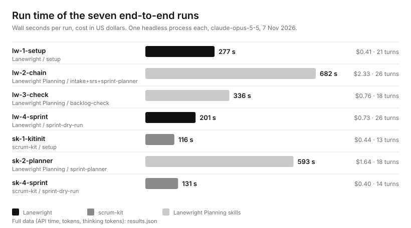
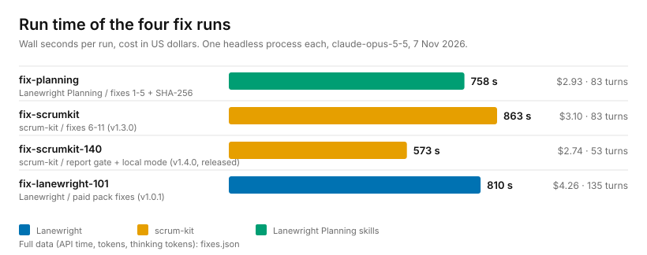

# End-to-end test of Lanewright Planning, Lanewright and scrum-kit (7 Nov 2026)

One question: can a one-line project brief go all the way to a running sprint, with the free
[Lanewright Planning](https://github.com/huzairsaputra/lanewright-planning) skills in front and either
[Lanewright](https://www.agensi.io/skills/lanewright-sprint-workflow-for-ai-coding-agent-teams) or the free
[scrum-kit](https://github.com/huzairsaputra/scrum-kit) behind?

(PNG copy for sites that do not show SVG: [runs.png](runs.png). Raw numbers: [results.json](results.json).)

## Method

- **Input:** one invented line, a small notes app for Python. No real project, organisation or document.
- **Seven runs, one process each:** headless `claude -p --bare`, API key only, model `claude-opus-5-5`,
  no other plugins, hooks or memory files, a spend cap per run. Two throwaway git repos, one per product,
  no remote.
- **Order:** set up the workflow (`lw-1`, `sk-1`); Intake, SRS and Sprint Planner (`lw-2`, then `sk-2` on
  the same SRS); Backlog Check (`lw-3`); a dry run of sprint 1 that must stop before any role is
  dispatched (`lw-4`, `sk-4`). The free script `backlog_check.py` was also run directly on the scrum-kit
  backlogs.
- **What is recorded for every run:** wall seconds, API milliseconds, turns, cost, tokens (including
  thinking tokens), exit code. The full table is in `results.json`.

## Results

| Run | What | Wall | API | Turns | Cost |
|---|---|---|---|---|---|
| lw-1-setup | Lanewright setup | 277 s | 130 s | 21 | $0.41 |
| lw-2-chain | Intake + SRS + Sprint Planner (Lanewright format) | 682 s | 641 s | 26 | $2.33 |
| lw-3-check | Backlog Check | 336 s | 196 s | 18 | $0.76 |
| lw-4-sprint | Lanewright sprint 1 dry run | 201 s | 182 s | 26 | $0.73 |
| sk-1-kitinit | scrum-kit setup | 116 s | 102 s | 13 | $0.44 |
| sk-2-planner | Sprint Planner (scrum-kit format) | 593 s | 450 s | 18 | $1.64 |
| sk-4-sprint | scrum-kit sprint 1 dry run | 131 s | 100 s | 14 | $0.40 |
| **Total** | | **2336 s** | | **136** | **$6.72** |

- All seven runs finished with exit code 0 and no error.
- **Planning is the slow, expensive part:** the three planning skills took 682 s and $2.33 once, and the
  planner alone 593 s and $1.64 for scrum-kit. Setup takes two to five minutes and costs under $0.50.
- **The script is not the slow part.** The free `backlog_check.py` checked all three scrum-kit backlogs
  against the SRS in 0.18 s (result: READY, 0 errors, 0 warnings). The agent's judgment review on top
  took 336 s.

What the planning skills produced from the one line:

| | Lanewright format | scrum-kit format |
|---|---|---|
| Format detected from `.claude/kit.json` | yes | yes |
| Intake | 7 sources, 23 cited facts, 12 gaps, 12 assumptions | same SRS reused |
| SRS | 6 functional (4 Must, 2 Should), 3 non-functional, 7 business rules | same |
| Sprints and backlog items | 3 sprints, 15 items, 48 of 60 SP | 3 sprints, 17 items, 44 of 60 SP |
| Any sprint or person over capacity | no | no |
| Language | Indonesian, because the brief is | Indonesian |

Both dry runs stopped where they should: the tool read the backlog, created the first item's branch,
and proved its ownership check blocks files outside the role's area (an allowed file passed, a planted
out-of-area file was refused), then stopped without opening a pull request.

## What did not work as it is

The point of an acceptance test is the list below. Each item was a real stop, or a guess that the agent
had to make and wrote down.

**Found in the free planning skills (fixes go into the next version of Lanewright Planning):**

1. A backlog file that only holds the template's placeholder row was treated differently by the two
   runs: one wrote the plan to `sprint-01-backlog.proposed.md`, the other overwrote the placeholder. The
   skill must say: a placeholder row means "no items".
2. Backlog Check gives one verdict for several files, so a clean `.proposed.md` is hidden behind the
   unfilled official file. It needs a verdict per file and a rule for non-interactive runs.
3. Backlog Check's script: the vague-wording check is skipped when a cell has any digit; the word list
   missed "berfungsi"; coverage counts a single item that merely mentions every requirement ID; the
   `{n}` and `{nn}` placeholders are mixed.
4. Intake has no fact type for the team; two rules disagree about what a "no answer" to the must-have
   question becomes; it is not stated whether repository files count as sources when the user gave only a
   brief.
5. Sprint Planner: "QA tests another person's work in the next sprint" and "implementers do not write
   tests" together push two Should features' tests past the deadline in the scrum-kit run (4 SP). The
   skill should make that conflict visible before planning, not discover it at the end. Also unclear:
   which language wins when the repository's own rules say English and the sources are Indonesian, and
   whether the 10% buffer is per sprint or per role.

**Found in the free scrum-kit plugin (tracked for scrum-kit 1.3.0):**

6. The setup writes the CI gate as `python ...`. On Windows that is often the Store placeholder and the
   gate exits with code 49 before running anything; the agents had to swap in `python3` or `py -3`.
7. Nothing commits the filled backlog, the weekly plan or the SRS before worktrees are created, so a
   role working in a worktree sees an empty template and cannot look up the requirement IDs its
   acceptance criteria cite.
8. The merge model assumes QA works on the same item as the implementer. A backlog with separate QA items
   (their own IDs and points) and items without any QA item has no route to a pull request.
9. `--module` is rejected when `kit.json` has an empty module list, and the steps do not say to leave
   it out for a single-module project.
10. The Definition of Done asks for an authorization test, and for documentation in a README that the
    ownership hook stops the implementer from writing. A project with no login should be able to waive
    the first, and the second needs an owner.
11. With no remote, the steps for the integration branch and the merge are not covered.

The Lanewright run met the same classes of problem. Its details stay with the product and are fixed
there; this page lists the free tools' findings so they can be checked.

## After the test: the fixes

The same day, the findings above were handed to four more headless runs (same setup, API key only,
`claude-opus-5-5`), each told to change as little as possible, add tests for every new behaviour, run
the checks and report. The author then re-ran the tests and the free scanner on each result before
anything was merged.

(PNG: [fixes.png](fixes.png). Raw numbers: [fixes.json](fixes.json).)

| Run | What | Wall | API | Turns | Cost | Result |
|---|---|---|---|---|---|---|
| fix-planning | findings 1-5 in the planning skills, plus a SHA-256 fingerprint of every checked backlog | 758 s | 679 s | 83 | $2.93 | 42 tests (5 new); released as [Lanewright Planning v1.0.1](https://github.com/huzairsaputra/lanewright-planning/releases/tag/v1.0.1) |
| fix-scrumkit | findings 6-11 in scrum-kit | 863 s | 728 s | 83 | $3.10 | 44 tests (7 new); released as [scrum-kit v1.3.0](https://github.com/huzairsaputra/scrum-kit/releases/tag/v1.3.0) |
| fix-scrumkit-140 | readiness-report gate (reads the fingerprint) and local mode for hotfix, release and kit-init | 573 s | 493 s | 53 | $2.74 | 48 tests (4 new); released as [scrum-kit v1.4.0](https://github.com/huzairsaputra/scrum-kit/releases/tag/v1.4.0) |
| fix-lanewright-101 | the paid pack's own fixes for the same classes of findings (details stay with the product) | 810 s | 720 s | 135 | $4.26 | 25 tests (9 new); private |
| **Total** | | **3004 s** | | **354** | **$13.03** | |

- **Tests plus fixes: 5340 s and $19.75** from the one-line brief to released fixes (7 test runs 2336 s
  and $6.72; 4 fix runs 3004 s and $13.03).
- **Cross-check of the gate.** The fingerprint written by the Backlog Check script and the one computed
  by the new scrum-kit script gave the same SHA-256 on a real backlog from the test, which is what lets
  scrum-kit tell a stale report from a current one.
- **The CLI caches by itself.** In each fix run 96-98% of the input tokens were read from cache
  (4.4 M, 5.4 M, 4.5 M and 9.1 M cache-read tokens against about 150-200 k written), so these costs
  already include the savings. The longest run (135 turns) cost the most because every turn re-reads
  the growing context, which is what the cache makes cheap. Cache-write and cache-read tokens are recorded per run in `fixes.json`.
- **Checks the author repeated, not just the agent:** unit tests, script self-tests, the build, the
  plugin validator, and a scan of the public repositories for names, paths, keys and text copied from the
  paid package (two generic `gh pr merge` and file-list lines in scrum-kit are known and harmless).

## Limits

- One invented project, one run per step, one model. Times depend on the machine, the network and the
  model's load that day; treat them as one data point and read the totals, not the second.
- The agents were told nobody could answer questions, so every interview used its defaults. A person
  answering would change the content, and probably the time.
- The dry runs stop before any role writes code. How a sprint itself performs is covered by the
  [fair benchmark](../fair-2026-11-06/) and not repeated here.
- Costs are the API cost reported by the tool for each run.

Run times are recorded for every run from now on; the next test adds a folder next to this one.
