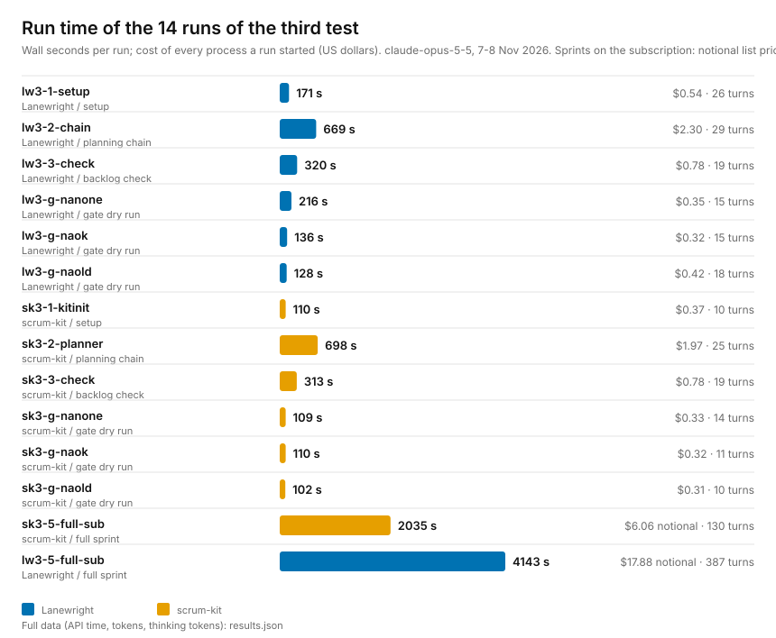

# Third end-to-end test: approving "not applicable" Definition-of-Done items (7-8 Nov 2026)

The second test ([gate-2026-11-07](../gate-2026-11-07/README.md)) ended with an open question: when a
role marks a Definition-of-Done (DoD) item "not applicable" (for example a negative authorization test in
an app with no login), who may approve that? Agents had either guessed or stopped. The fix, released as
[Lanewright Planning v1.0.2](https://github.com/huzairsaputra/lanewright-planning/releases/tag/v1.0.2) and
[scrum-kit v1.4.1](https://github.com/huzairsaputra/scrum-kit/releases/tag/v1.4.1) (and folded into
Lanewright 1.0.1), is a contract:

- the Sprint Planner **proposes** DoD items that may not apply, each with a reason from the SRS;
- the Backlog Check report lists the proposals; its sign-off block has a field `DoD not applicable
  (approved):` that only a human fills;
- the sprint workflow treats an item as approved only if that field names it **and** the report's SHA-256
  fingerprint still matches the backlog; otherwise the line reads "pending product-owner approval", is not
  counted as met, and the integration branch is **never merged into the base branch** while one is pending.

This test checks that the contract works with the released versions.

(PNG: [runs.png](runs.png). Raw numbers and tokens per run: [results.json](results.json).)

## Method

- **Input:** the same invented one-line notes-app brief as the earlier tests; one fresh throwaway
  repository without a remote per workflow tool, local mode. Both tools plan from the same SRS.
- **12 headless runs on an API key** (`claude -p --bare`, `claude-opus-5-5`): setup, the planning chain,
  Backlog Check, and per tool three gate dry runs. The dry runs follow the sprint preparation up to the
  readiness gate and stop before dispatching any role.
- **Three states of the sign-off**, each in its own copy of the same repository (the human is simulated by a
  script that fills the sign-off block):

  | State | DoD field of the sign-off | Expected reading |
  |---|---|---|
  | naok | names the "negative authorization test" item | approved; a later "not applicable" mark on it is accepted without asking |
  | nanone | says none | no item approved; a later mark means "pending product-owner approval" |
  | naold | report in the old format, no such field | same as none |

- **Two full sprints on the Claude Code subscription**, one per tool, in the repositories left by the
  dry-run chain (field says none, nobody can answer). They ran isolated from the researcher's own settings:
  no user `CLAUDE.md`, skills, plugins or MCP servers, no API key (`apiKeySource` of the init message was
  `none`). Cost on the subscription is not billed; the figures here are the notional list price.
- Costs of the sprints come from the transcripts of every process, because the report of the main
  process covers only that process.

## Results

### The contract: read correctly in all 6 dry runs, and held in both sprints

| State | Lanewright | scrum-kit |
|---|---|---|
| naok | approved set read correctly | approved set read correctly |
| nanone | empty set, "pending" rule quoted | empty set, "pending" rule quoted |
| naold | read as "none approved" | read as "none approved" |

A proposal from the planner was read as a proposal only, never as an approval.

In the two full sprints the roles marked the "no login" DoD items not applicable (scrum-kit: one item
class on all six items; Lanewright: two classes, six entries in all). Nobody could approve, so in both
sprints:

- each such line was recorded as "pending product-owner approval", unticked, in the merge notes and the
  handover;
- every item still merged into the integration branch because all its other DoD items were met;
- the sprint stopped after the close-out commit and listed every pending approval;
- **the integration branch was not merged into the base branch** (the base branch stayed on the commit of
  the sprint documents).

| | Lanewright | scrum-kit |
|---|---|---|
| Items merged into integration | 6 of 6 (17 SP) | 6 of 6 (17 SP) |
| Tests at the end | 115 (3 skipped on Windows) | 55 |
| Reviews | CLEAN on all merges (one item needed four rounds) | CLEAN on all three merges |
| Merged into the base branch | no, 6 approvals pending | no, 1 approval pending |
| Processes | 26 | 11 |
| Wall time | 4143 s (one pause, see below) | 2035 s |
| Notional cost, all processes | $17.88 | $6.06 |
| Turns | 387 | 130 |

### One finding about the test, not the contract

In the Lanewright dry runs the new Backlog Check returned NOT READY, because an old test called `add()`
without an author, so the first backend item could not merge with green tests. The three Lanewright dry
runs therefore stopped at the gate. For the full sprint the standing answers continued with a written
reason (the finding is resolved inside the sprint); the sprint then fixed it. The approval script of the
harness signs any report whatever its verdict. That is a weakness of the simulation, not of the tools.

### Pause

The Lanewright sprint stopped once at the account's five-hour usage limit after 3701 s. It was resumed in
the same session from the handover and the git state and finished in 442 s without redoing finished items.
The scrum-kit sprint ran uninterrupted.

The limit is a usage quota of the subscription account, counted on the provider's side in model tokens
and shared by every session of that account. It is not a fault of the tools and not a lack of local
resources. Both sprints ran at the same time on the same account, next to the researcher's own
interactive session, which together used up the five-hour allowance; the error was a 429
`usage_limit_reached`. The 4143 s is the 3701 s before the stop plus the 442 s after the resume; the waiting time in between
is not counted.

## Limits

- One small invented repository, one run per cell: a direction, not a rate.
- The two sprints shared one laptop and one account while they ran in parallel, so their wall times may
  be inflated by competing for CPU and for the account's usage quota. This was not measured; compare the
  two sprints with each other only as a direction. A study that compares conditions should run them one at
  a time.
- The role processes started by either sprint inherited the researcher's settings; only the orchestrating
  process was isolated. The Lanewright sprint ran four security-audit rounds on its first item, which is
  probably why it cost about three times as much as the scrum-kit sprint; this test does not isolate that.
- The "approval" in this test is always absent. Whether a real product owner decides well is a question for
  the later study, not for this harness.

## Run time and cost of this test

| | Runs | Wall seconds | Cost |
|---|---|---|---|
| 12 runs on an API key | 12 | 3082 | $8.79 |
| 2 full sprints on the subscription | 2 | 6178 | not billed ($23.94 notional) |

All figures recorded per run in [results.json](results.json); redraw the chart with `py -I charts.py`.
